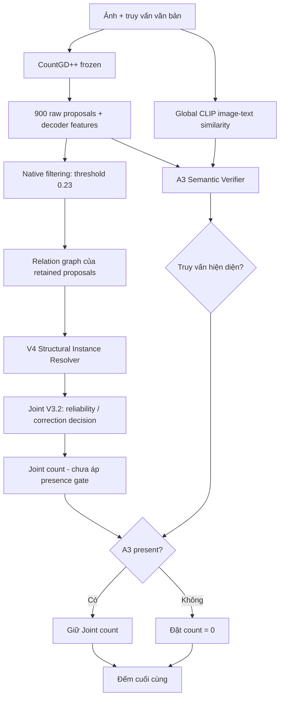

# Joint Semantic Counting: Kết hợp nhận biết đối tượng và hiệu chỉnh số lượng

> **Phạm vi tài liệu:** Giải thích bài toán, ý tưởng, các thành phần đã triển khai và kết quả đánh giá của **CountGD++ → Structural V4 → Joint V3.2 → A3**. Tài liệu tập trung vào *phương pháp nghiên cứu*; lệnh cài đặt và tái lập kết quả nằm trong [`RUN.md`](RUN.md).

## 1. Bài toán và động lực nghiên cứu

### 1.1. Text-guided object counting là gì?

Đầu vào gồm **một ảnh** và **một truy vấn văn bản** mô tả loại đối tượng cần đếm, chẳng hạn `strawberry`, `bottle` hoặc `person`. Đầu ra là **số lượng đối tượng phù hợp với truy vấn** trong ảnh.

Ví dụ, nếu ảnh có 5 quả dâu và 3 quả việt quất, truy vấn `strawberry` phải cho kết quả 5; truy vấn `blueberry` cho kết quả 3; truy vấn `elephant` phải cho kết quả **0**.

Trong hướng **zero-shot/open-world counting**, hệ thống được kỳ vọng làm việc với nhiều loại đối tượng, bao gồm loại đối tượng chưa xuất hiện trong các lớp huấn luyện của bộ đếm.

### 1.2. Vì sao CountGD++ chưa giải quyết trọn vẹn bài toán?

Nhóm sử dụng **CountGD++** làm mô hình nền (*backbone/baseline*). Mô hình sinh các *proposal* (vùng ứng viên, thường biểu diễn bằng bounding box) cho truy vấn và lọc ra các proposal được giữ lại. Tuy nhiên, **một proposal không nhất thiết tương ứng đúng một đối tượng vật lý**:

- **Đếm dư:** Hai hoặc nhiều box cùng chỉ một vật thể, gây đếm trùng.
- **Đếm thiếu:** Một box chứa nhiều vật thể, hoặc vật thể bị lọc bỏ, làm số đếm thấp hơn thực tế.
- **Sai đối tượng:** Khi đối tượng trong truy vấn không tồn tại, mô hình vẫn có thể giữ các box của đối tượng khác và dự đoán số dương.

Hai nhóm lỗi cuối cùng dẫn đến hai câu hỏi cần xử lý riêng:

| Thành phần | Câu hỏi cần trả lời | Ví dụ lỗi |
|---|---|---|
| **WHAT — Semantic presence** | Ảnh có đúng loại đối tượng được hỏi không? | Hỏi `elephant`, ảnh không có voi nhưng vẫn dự đoán 4 |
| **HOW MANY — Structural counting** | Các proposal thực sự đại diện cho bao nhiêu đối tượng? | Một vật thể bị phát hiện hai lần hoặc một box chứa ba vật thể |

**Mục tiêu nghiên cứu:** Kết hợp hiệu chỉnh số lượng (**V4/Joint V3.2**) với kiểm tra sự hiện diện (**A3**) nhằm giảm sai số đếm, đặc biệt trong trường hợp truy vấn không xuất hiện trong ảnh.

## 2. Tổng quan phương pháp đề xuất

Sơ đồ mô tả **hai nhánh xử lý song song**: nhánh **HOW MANY** tạo số đếm và nhánh **WHAT** quyết định có nên cho phép số đếm đó hay không. A3 là *presence gate* áp dụng **sau** số đếm Joint V3.2; nó không đồng nghĩa với việc huấn luyện lại Joint V3.2 hay thay thế các contribution của V4.

### 2.1. Đầu vào/đầu ra của từng giai đoạn

| Giai đoạn | Đầu vào chính | Đầu ra / vai trò |
|---|---|---|
| CountGD++ | Ảnh + text query | Raw proposals, scores, decoder hidden states và native count |
| Native filter | Raw proposals/scores | Các proposal giữ lại theo quy tắc frozen |
| Structural V4 | Retained proposals và relation graph | Contribution cấu trúc, từ đó có `Count_V4` |
| Joint V3.2 | Frozen V4 features/contributions và tín hiệu reliability | `Count_Joint` sau quyết định chấp nhận hiệu chỉnh |
| Semantic A3 | Raw proposal features + CLIP similarity | Pair-level presence score và quyết định có/không |
| Final gate | `Count_Joint`, quyết định A3 | `Count_Joint+A3`, hoặc 0 nếu A3 từ chối |

## 3. Chi tiết thành phần HOW MANY

### 3.1. CountGD++ và proposal gốc

Trong pipeline đã sử dụng, CountGD++ tạo **900 raw proposals** cho mỗi cặp ảnh–truy vấn. Mỗi proposal có thông tin vùng ảnh, điểm tin cậy và **decoder hidden state 256 chiều**.

Pipeline gốc lọc proposals với ngưỡng confidence frozen **0.23** (kèm bước so sánh positive/rest logits theo cách CountGD++ triển khai). Các proposal giữ lại là đầu vào cho graph của V4. Một điểm quan trọng là **V4 không chạy trực tiếp trên toàn bộ 900 raw proposals**, mà trên tập proposal đã qua bước lọc native.

### 3.2. Structural V4 — sửa đóng góp của từng proposal

**Ý tưởng:** Không mặc định mọi proposal được giữ lại đều đóng góp đúng 1 vào tổng số đếm. V4 học quan hệ giữa các proposal để điều chỉnh đóng góp này.

**Bước 1 — Xây relation graph.** Mỗi proposal giữ lại được biểu diễn thành một node. Quan hệ giữa các node được mô tả bởi thông tin hình học/chồng lấp và các **edge features (7 chiều)** theo implementation xây graph của dự án. Đặc trưng decoder và thông tin proposal hỗ trợ mô hình học việc các box có thể trùng lặp hay gộp nhiều vật thể. *Ground-truth labels chỉ phục vụ huấn luyện/đánh giá, không phải feature được phép dùng lúc inference.*

**Bước 2 — Ước lượng contribution.** V4 sử dụng hai hướng hiệu chỉnh **REDUCE** (giảm đóng góp khi có nguy cơ đếm trùng) và **EXPAND** (tăng đóng góp khi proposal có thể đại diện nhiều đối tượng); trạng thái mặc định **KEEP** tương ứng đóng góp gần 1.

Công thức contribution của proposal $i$:

$$
 r_i = \max\!\left(0,\ 1-p_i^{\mathrm{reduce}}d_i+p_i^{\mathrm{expand}}e_i\right).
$$

Trong đó:

- $p_i^{\mathrm{reduce}}$ và $p_i^{\mathrm{expand}}$ là các tín hiệu điều khiển nhánh (sigmoid).
- $d_i$ là cường độ giảm; $e_i$ là cường độ tăng (nhánh expand dùng softplus).
- Phép chặn dưới ở 0 bảo đảm contribution không âm.

Tổng số đếm cấu trúc có thể biểu diễn bằng phép cộng contribution trên tập node mà V4 xử lý:

$$
 \widehat{N}_{\mathrm{V4}}=\sum_{i\in P_{\mathrm{native}}}r_i.
$$

**Ví dụ minh họa:** Nếu ba proposal có contribution lần lượt 0,2; 0,8; 1,9 thì V4 cho số đếm mềm 2,9 thay vì mặc định đếm ba box thành 3. Đây chỉ là ví dụ giải thích ý nghĩa contribution, **không phải output của một mẫu cụ thể**.

**Giới hạn:** V4 chỉ hiệu chỉnh các retained proposals. Nếu CountGD++ đã loại một đối tượng khỏi tập node, V4 không mặc nhiên khôi phục lại proposal đã mất. Nhánh EXPAND cũng có thể gây sai số lớn nếu ước lượng sai.

### 3.3. Joint V3.2 — quyết định khi nào nên áp dụng correction

**Vì sao cần thêm Joint V3.2?** V4 có thể giảm MAE trung bình nhưng **có ảnh cải thiện, có ảnh bị làm sai hơn**. Áp dụng structural correction một cách thiếu chọn lọc có thể làm hỏng trường hợp native đã đếm gần đúng.

Joint V3.2 bổ sung một tầng **reliability-aware correction**: sử dụng các tín hiệu đã học/đóng băng về rủi ro đếm, trạng thái proposal và thông tin liên quan để đánh giá liệu correction có đáng tin cậy hay không. Các artifact chạy thử/phân tích của hệ thống thể hiện các trường như `p_over` (tín hiệu rủi ro overcount) và `accepted_correction` (quyết định chấp nhận hiệu chỉnh).

Diễn giải quy trình ở mức chức năng:

1. Nhận proposal graph và kết quả hiệu chỉnh cấu trúc V4.
2. Ước lượng tín hiệu **reliability/risk** cho correction, thay vì xem mọi trường hợp là như nhau.
3. Theo quy tắc **frozen** của phiên bản V3.2, quyết định những hiệu chỉnh nào được chấp nhận.
4. Tổng hợp thành số đếm **`Joint V3.2` (no presence gate)**.

**Cần phân biệt:** Joint V3.2 **không phải** `V4 + A3`. Trong kết quả P14, `Joint V3.2` là phương pháp đếm có correction/risk logic riêng; `Joint V3.2 + A3` mới là phiên bản được đặt thêm semantic presence gate.

Tài liệu nguồn đang đóng gói xác nhận các giai đoạn và tên trường nói trên, nhưng **chưa đủ để trình bày một công thức đóng hoàn chỉnh cho router, tập feature chính xác và mọi hệ số/ngưỡng của Joint V3.2**. Không tự gán công thức, trọng số hoặc threshold chưa được kiểm tra; cấu hình frozen và code tính toán tương ứng phải đối chiếu ở `candidate_freeze.json` và `scripts/p14_08b_09_joint_unified.py` khi công bố chi tiết implementation.

## 4. Chi tiết thành phần WHAT: A3 Semantic Verifier

### 4.1. A3 giải quyết vấn đề gì?

Một mô hình có thể đếm chính xác *số proposal* nhưng lại đếm **sai loại đối tượng**. Ví dụ, ảnh không có `elephant` nhưng CountGD++ vẫn trả số dương vì proposal khớp nhầm đối tượng khác. Structural V4/Joint V3.2 không tự bảo đảm khắc phục lỗi semantic này. A3 được dùng để dự đoán **truy vấn có hiện diện trong ảnh hay không**.

### 4.2. Đầu vào và mô hình

A3 được huấn luyện với proposal-level supervision trên dữ liệu semantic LVIS. Các thành phần nổi bật:

- **256 chiều** decoder hidden state từ từng **raw proposal** của CountGD++.
- **1 đặc trưng** global CLIP cosine giữa ảnh và truy vấn văn bản; cấu hình nghiên cứu sử dụng CLIP `ViT-B-32-quickgelu`, prompt dạng `a photo of {query}`.
- Tổng cộng **257 chiều** đầu vào cho mô hình semantic. A3 dùng MLP với các tầng 128 → 64 → 1 và đầu ra sigmoid score. Các thông số chuẩn hóa CLIP được lấy từ dữ liệu TRAIN, không ước lượng lại từ tập TEST.

Điểm khác biệt cần nhớ: A3 xét **900 raw proposals**, không giới hạn ở những node đã được CountGD++ native filter giữ lại. Nhờ đó, bài toán semantic được phân tích rộng hơn tập node dùng cho structural counting.

### 4.3. Từ proposal score thành quyết định presence của cả cặp

Gọi $s_i$ là điểm semantic của raw proposal $i$. Score của toàn bộ cặp ảnh–truy vấn được lấy theo:

$$
 S_{\mathrm{A3}}(I,q)=\max_{i=1,\ldots,900}s_i.
$$

Dùng ngưỡng A3 đã được khóa trước đánh giá FSC147:

$$
 \tau_{\mathrm{A3}}=0.9910586476325989.
$$

Quyết định hiện diện:

$$
 g_{\mathrm{A3}}(I,q)=
 \begin{cases}
 1,& S_{\mathrm{A3}}(I,q)\geq\tau_{\mathrm{A3}},\\
 0,& \text{ngược lại.}
 \end{cases}
$$

Giá trị này là **điểm/decision của verifier**, không được tự gọi là xác suất đã được hiệu chuẩn (*calibrated probability*).

### 4.4. Cách A3 kết hợp với Joint V3.2

Công thức final count của phiên bản đang đánh giá:

$$
 \boxed{\widehat{N}_{\mathrm{Joint+A3}}(I,q)
 =g_{\mathrm{A3}}(I,q)\,\widehat{N}_{\mathrm{Joint}}(I,q)}
$$

Tức là:

- **A3 = 1:** giữ nguyên prediction từ Joint V3.2.
- **A3 = 0:** cho output **0**, vì hệ thống đánh giá truy vấn không hiện diện.

Ví dụ: Joint V3.2 dự đoán 7 nhưng A3 nhận định đối tượng vắng mặt thì final count = 0; nếu A3 xác nhận hiện diện thì vẫn là 7. **A3 không tự sửa 7 thành 5 hay 6** — chức năng ở đây là quyết định *cho qua hay từ chối số đếm*.

Kiểm tra provenance P17-02 đã xác nhận việc áp gate đúng trên **1.301/1.301 pairs**, cho cả CountGD+A3 và V4+A3; kết quả Joint V3.2+A3 đã được đánh giá bằng frozen prediction P14.

## 5. Bộ dữ liệu đánh giá FSC147 + 111 hard negatives

### 5.1. FSC147 TEST — truy vấn hiện diện

Nhóm sử dụng **1.190 ảnh–truy vấn positive** thuộc official FSC147 TEST. Mỗi cặp có nhãn số lượng đối tượng thực tế và **3 exemplar boxes** theo thiết lập test đang sử dụng.

### 5.2. Absent111 — truy vấn không hiện diện

Để kiểm tra lỗi *đếm đối tượng không có trong ảnh*, nhóm sử dụng tập diagnostic gồm **111 image–query pairs** được xác minh là absent (`presence_label = 0`, `count_target = 0`). Chúng tham chiếu đến **96 ảnh riêng biệt đã nằm trong FSC147**.

**111 không đồng nghĩa 111 ảnh bổ sung:** một ảnh FSC147 có thể được gán nhiều truy vấn absent. Do đó không cần tải hoặc copy 111 ảnh mới.

Các file dữ liệu kèm repo:

| File | Vai trò |
|---|---|
| `generated/fsc147_presence_v4/test_pairs_1301.csv` | Danh sách đầy đủ 1.190 positive + 111 absent pairs; bao gồm `pair_id`, `file_name`, `image_path`, `query`, `presence_label`, `count_target`, `num_exemplars`... |
| `generated/fsc147_presence_v4/annotation_absent111_empty.json` | Annotation phục vụ các truy vấn absent; không có đối tượng GT thuộc category được hỏi |
| FSC147 official images/annotations | Người chạy tự tải từ nguồn dữ liệu gốc; **không được đưa ảnh vào repo này** |

### 5.3. Unified protocol

**Unified1301 = FSC147 TEST1190 + Absent111.** Mỗi dòng là một cặp ảnh–truy vấn, không phải nhất thiết một ảnh duy nhất. Việc nối kết prediction với GT sử dụng `pair_id` và kiểm tra uniqueness, không ghép tùy tiện theo thứ tự dòng.

| Tập | Số cặp | GT | Exemplars trong protocol |
|---|---:|---|---:|
| FSC147 TEST | 1.190 | Số lượng dương | 3 |
| Absent111 | 111 | 0 | 0 |
| **Unified** | **1.301** | Hỗn hợp | Hỗn hợp |

**Lưu ý phương pháp luận:** 111 negative pairs là **hard negatives được chọn dựa trên lỗi CountGD++**, không phải mẫu ngẫu nhiên đại diện cho tất cả absent queries. Positive/negative còn khác nhau về việc có exemplar. Đây là các hạn chế bắt buộc phải công bố khi diễn giải kết quả.

## 6. Phương pháp đánh giá

Các phép đo áp dụng cho cùng các `pair_id`, GT và prediction frozen ở các mô hình. Với $n$ cặp, GT $y_j$, prediction mềm $\hat y_j$:

$$
 \mathrm{MAE}=\frac{1}{n}\sum_{j=1}^{n}|\hat y_j-y_j|,
 \qquad
 \mathrm{RMSE}=\sqrt{\frac{1}{n}\sum_{j=1}^{n}(\hat y_j-y_j)^2}.
$$

- **MAE (↓):** sai số tuyệt đối trung bình, càng thấp càng tốt.
- **RMSE (↓):** nhạy hơn với trường hợp sai rất lớn.
- **Exact-count Accuracy (↑):** tỷ lệ cặp có prediction **làm tròn về số nguyên không âm** đúng bằng GT. MAE/RMSE ở trên vẫn tính trên **giá trị prediction mềm**, không phải số đã làm tròn.
- **Acc@±1 / Acc@±5 (↑):** tỷ lệ số đếm nguyên sai lệch GT không quá 1 / không quá 5.
- **Zero-count Accuracy:** trên absent111, tỷ lệ dự đoán số 0 sau làm tròn; đồng thời có thể theo dõi `Strict_Zero` để tránh hiểu nhầm số rất nhỏ là zero thật.
- **HELP / HARM / SAME:** so sánh **sai số tuyệt đối từng cặp** với CountGD++ (hoặc nêu rõ baseline khác). HELP khi nhỏ hơn, HARM khi lớn hơn, SAME khi bằng nhau; không phải số cặp đếm đúng tuyệt đối.

Tập Unified dùng trung bình theo **1.301 cặp**, nên 1.190 positive có trọng số lớn hơn 111 absent. Nếu muốn cân bằng tầm quan trọng hai nhóm, báo cáo thêm **Balanced MAE**:

$$
 \mathrm{Balanced\ MAE}=\frac{\mathrm{MAE}_{1190}+\mathrm{MAE}_{111}}{2}.
$$

Không so Balanced MAE trực tiếp với Unified MAE vì hai cách gộp có trọng số khác nhau.

## 7. Kết quả thực nghiệm frozen (P14/P17)

### 7.1. So sánh sáu phương pháp

| Phương pháp | FSC147 TEST MAE ↓ | Absent111 MAE ↓ | Unified MAE ↓ | Unified RMSE ↓ | Unified Exact Acc ↑ |
|---|---:|---:|---:|---:|---:|
| CountGD++ | 11.6504 | 62.5225 | 15.9908 | 99.1810 | 30.21% |
| V4 seed42 | 10.9379 | 61.2487 | 15.2303 | 98.2114 | 32.82% |
| CountGD++ + A3 | 11.6504 | 47.2342 | 14.6864 | 98.6841 | 33.59% |
| V4 seed42 + A3 | 10.9379 | 46.2394 | 13.9498 | 97.7272 | 36.20% |
| Joint V3.2 | **10.1488** | 61.2487 | 14.5086 | 97.6985 | 33.82% |
| **Joint V3.2 + A3** | **10.1488** | **46.2394** | **13.2280** | **97.2118** | **37.20%** |

Kết quả Unified của **Joint V3.2 + A3** so với CountGD++:

- MAE giảm từ **15.9908 xuống 13.2280**, tương ứng **17.28%**.
- RMSE giảm từ **99.1810 xuống 97.2118**, tương ứng khoảng **1.99%**.
- Exact count tăng từ **393/1301** lên **484/1301**, thêm **91 cặp**.
- Trên FSC147 TEST positive, Joint V3.2 giảm MAE từ **11.6504** xuống **10.1488** (khoảng **12.89%**).

### 7.2. Ablation: từng thành phần mang lại điều gì?

**V4 so với CountGD++:** MAE positive từ 11.6504 → 10.9379: structural relation/contribution giúp cải thiện số lượng, nhưng còn những cặp bị làm sai hơn.

**Joint V3.2 so với V4:** MAE positive từ 10.9379 → 10.1488: reliability-aware correction giúp cải thiện thêm trên phần đếm khi đối tượng thực sự hiện diện.

**A3 trên positive:** Trong toàn bộ 1.190 cặp FSC147 TEST, A3 **không đổi prediction nào**, vì vậy Joint V3.2 và Joint V3.2+A3 có cùng MAE **10.1488** ở nhóm này.

**A3 trên absent:** A3 từ chối đúng **44/111** absent pairs, nâng zero-count accuracy từ **0%** lên **39.64%** trong hard-negative diagnostic; **67/111** truy vấn vẫn bị cho qua. Khi thêm A3 vào V4/Joint, absent MAE giảm từ **61.2487** xuống **46.2394**.

**Lưu ý:** Joint V3.2 **không tự giảm MAE absent so với V4** trong kết quả hiện tại: hai phương pháp đều có absent MAE **61.2487**. Cải thiện ở nhóm absent của final method đến từ **A3**.

### 7.3. Phân tích HELP/HARM

So với CountGD++ trên Unified1301, **Joint V3.2 + A3** có **744 HELP**, **557 HARM**, **0 SAME** theo sai số tuyệt đối từng cặp. Như vậy phương pháp cải thiện tổng thể nhưng **không tốt hơn baseline ở mọi ảnh**. RMSE giảm ít hơn MAE cũng cho thấy một số trường hợp sai lớn vẫn đáng chú ý.

Với riêng thao tác thêm A3 vào CountGD hoặc V4, P17-02 ghi nhận **44 HELP / 0 HARM / 1.257 SAME**, vì chỉ 44 absent pairs bị đổi prediction về 0. Đây là kết quả trên **protocol hiện có**, không phải chứng minh bộ gate không bao giờ từ chối nhầm truy vấn dương trong dữ liệu khác.

## 8. Giới hạn và tính tái lập

1. **Official TEST đã được quan sát:** Không dùng các kết quả này để chỉnh threshold, chọn checkpoint hoặc tune model. P14/P17 là đánh giá *post-hoc* trên protocol frozen, **không phải blind evaluation mới**.
2. **Negative có selection bias:** 111 hard negatives được chọn từ lỗi CountGD++, vì thế cải thiện trên nhóm này không ước lượng trực tiếp hiệu quả trên absent queries ngẫu nhiên.
3. **Khác biệt exemplars:** Positive có ba exemplar boxes, negative không có exemplar; tín hiệu này có thể ảnh hưởng việc quyết định presence.
4. **A3 có rủi ro false rejection ngoài mẫu:** Trên 1.190 positive pairs hiện tại không có trường hợp bị từ chối, nhưng không suy rộng thành bảo đảm tổng quát.
5. **Không bảo đảm cải thiện từng ảnh:** Joint V3.2+A3 vẫn có 557/1.301 cặp HARM so với CountGD++.
6. **Tái lập cần phân tầng:** Repo hiện **đã kiểm thử thành công việc tính lại số liệu từ frozen CSV bằng CPU**. Việc tái lập toàn bộ inference từ ảnh, pretrained CountGD++, checkpoints V4/A3 và các cache đồ thị/decoder **chưa được kiểm tra trên máy sạch**. Không mô tả CPU replay như một full end-to-end reproduction.

## 9. Đối chiếu implementation và artifact trong repo

| Thành phần | File/nguồn kiểm tra |
|---|---|
| Frozen experiment configuration | `outputs/joint_semantic_counting_v1/p13_joint_v32_candidate_freeze_v1/candidate_freeze.json` |
| Dataset manifest và absent annotations | `generated/fsc147_presence_v4/` |
| CountGD/V4 frozen predictions | `outputs/joint_semantic_counting_v1/p14_06_unified_matched_v1/unified_predictions.csv` |
| A3 scores/decisions | `outputs/joint_semantic_counting_v1/p14_07b_a3_fullraw_fsc_unified_v1/a3_unified_1301_predictions.csv` |
| V4 node contributions | `outputs/joint_semantic_counting_v1/p14_08a_frozen_v4_node_contrib_unified_v1/frozen_v4_a3_unified_nodes.npz` |
| Joint V3.2 + A3 final predictions | `outputs/joint_semantic_counting_v1/p14_08b_09_joint_unified_frozen_v1/unified_per_pair_predictions.csv` |
| A3 model definition | `scripts/train_s1_semantic_verifier_a3_clip_v1.py` |
| V4 encoder | `scripts/train_instance_relation_encoder_v4.py` |
| Joint correction logic | `scripts/p14_08b_09_joint_unified.py` và các module được import |
| Paired three-view evaluation | `scripts/p17_01_three_view_paired_eval_v1.py` |

**Tóm lại:** Phương pháp không đơn giản là lấy hai mô hình cộng lại. **V4** xử lý *mỗi proposal đóng góp bao nhiêu*, **Joint V3.2** xử lý *correction nào đáng tin cậy để áp dụng*, và **A3** xử lý *đối tượng được hỏi có hiện diện hay không*. Khi kết hợp theo đúng pipeline frozen, nhóm giảm Unified MAE từ **15.9908 xuống 13.2280**, đồng thời giữ rõ giới hạn của đánh giá FSC147 TEST + 111 hard negatives.
