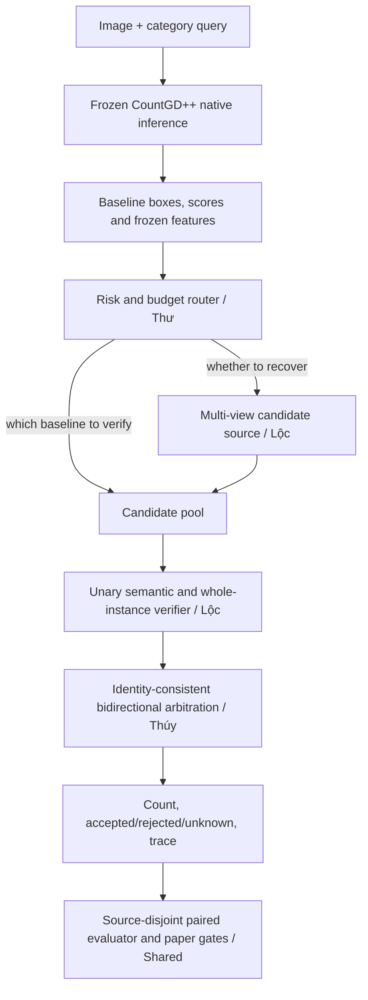

# UNICOUNT v1 — one unified CS331 research method (working name)

**Status:** Implemented **CPU replay of frozen candidate/evidence inputs**. GPU integration, newly learned methods, fairness/parity and the A* contribution are **NOT** complete. The name UNICOUNT is internal and does not imply novelty.

## 1. One research question, not three independent methods

> For frozen open-world counting, can an uncertainty-aware, budgeted, instance-level evidence reconciliation controller jointly correct spurious detections and recover missed instances, while controlling identity errors and query-level compute?

This is one *method hypothesis* shared by all three contributors. The main output is a count with a candidate-level evidence trace; scalar MAE and region/identity quality are measured together. Every method component must improve that pipeline, not create a separate leader board without an interface.

## 2. Exact pipeline and integration locations

- CountGD++ image encoder, text encoder, feature enhancer, cross-modal transformer and pretrained weights remain unchanged. We change the **candidate sourcing, verification and count decision downstream**. Different pseudo-exemplar operating points are separate experiments, not interchangeable.
- **Router / Thư:** reads GT-blind proposals, confidence and *optionally* validated learned structural/semantic risk features; prioritizes verification under a fixed budget. Her FSC147 Joint V3.2 count corrector is **not** silently added to physical-instance counting; treat it as a matched comparator until there is a justified mapping from its output to instance decisions. The current CPU router uses a deterministic confidence/risk-hint priority, not her trained model.
- **Recovery + verifier / Lộc:** cross-view proposals from frozen CountGD++ or multi-scale inference; Qwen3-VL provides semantic + whole-instance verdicts for individual regions. Lộc V7.6 is a **global image-level category veto** and must not be misrepresented as already satisfying the region-level verifier interface. In v1 the repo takes precomputed evidence; the GPU model adapter remains unconnected.
- **Arbitration + identity / Thúy:** baseline `NO/NO` -> reject, baseline unknown -> retain; unmatched rescue `YES/YES` may be admitted; matched rescue does not increment count; complete-link `SAME` identity edges allow multi-view duplicates to merge, unresolved overlapping proposals stay UNKNOWN. The current graph rule is a conservative v1 candidate, **not** a new optimizer or certified identity resolver.

## 3. Inference states and policy, v1 (locked at code version)

Candidate unary evidence `semantic, whole_instance ∈ {YES,NO,UNKNOWN}`. Only `YES/YES` can be accepted, only `NO/NO` may reject a baseline. All mixed/missing states are UNKNOWN. UNKNOWN baseline preserves its count contribution; UNKNOWN rescue cannot create a new count.

Let `B` be baseline candidates and `R` the unmatched accepted rescue groups after identity arbitration. With `D_B` explicitly rejected baseline candidates:

`N_point = |B| - |D_B| + |R|`

Original-coordinate overlap ≥0.5 between baseline and rescue suppresses double counting; this is a **heuristic correspondence**, not identity proof. If a matched accepted rescue contradicts a rejected baseline, change baseline to UNKNOWN (do not delete it or add one).

Identity merges require a complete clique of `SAME` edges, distinct source views and overlap feasibility. Two overlapping rescue groups with no `DIFFERENT` evidence are **not counted** in v1: both remain unknown until stronger pairwise evidence is available. This conservative policy sacrifices recall to avoid unsupported additions. Identity-off is an ablation, not the proposed safe default.

All outputs report an observed-candidate interval and `partial`/`abstained`; that interval is **NOT a bound on the true full-scene object count**. A real abstention withholds `count`; `evaluation_fallback_count` is stored separately for fair full-cohort evaluation. No GT fields may appear in the inference JSON.

## 4. Source-to-module mapping and reproducibility

| Stage | Shared runtime file | Owner | Original source | Current status |
|---|---|---|---|---|
| Frozen native CountGD++ | `method/schema.py` + future `adapters/countgd_native.py` | Shared | frozen checkpoints/protocols in legacy | Requires genuine GPU adapter and parity |
| Structural/risk router | `method/router.py` | Thư | `legacy/thu/scripts/p14_08b_09_joint_unified.py` | CPU fallback implemented; learned feature adapter TODO |
| Multi-scale rescue | candidate manifest + future `adapters/loc_recovery.py` | Lộc | `legacy/loc/notebooks/03_refinements/`, `04_validation/` | Precomputed proposals only; native GPU adapter TODO |
| Instance unary verifier | `method/verifier.py` | Lộc | `legacy/loc/notebooks/01_original_pipeline/V7_Dual_Evidence_Router.ipynb`; `legacy/thuy/branch/` | Frozen evidence replay; per-instance Qwen contract TODO |
| Identity + reconciliation | `method/identity.py`, `method/pipeline.py` | Thúy | `legacy/thuy/branch/safe_iic.py`, `bidirectional_evidence_controller.py` | Conservative CPU implementation + tests; instance GT validation TODO |
| Legacy FQIE adapter | `adapters/fqie_legacy.py` | Thúy | V14 `bidirectional_task_index.json`, `identity_unary_decisions.jsonl` | Parses actual expected frozen schema; no actual V14 raw file provided |
| Paired evaluation | `countlab/audit.py` | Shared | historical metrics | CPU evaluator exists; provenance parity TODO |

The *code path* currently implemented is **offline candidate/evidence replay**, not a GPU end-to-end counting system. Every new backend must implement the same contract and match the frozen source on a parity fixture before test evaluation.

## 5. Claims and unresolved risks

- V14 reported LVIS-derived 180-pair MAE `1.7611 -> 1.1000`; rejection-only `1.1167`, rescue-only `1.7444`. Raw V14 provenance artifacts absent in mirror; this is a **reported past result**, **not** UNICOUNT v1's tested result.
- Thư Joint V3.2+A3 on a 1301-pair explored FSC/test+hard-neg cohort is a **distinct trained protocol**. Lộc PrACo official adapter Test-1 had better class-mismatch suppression but worse positive MAE; **different operating points**.
- A* novelty **not established**: detect-and-verify, semantic veto, adaptive crop and conservative counting each have prior art. A credible contribution requires a new verified arbitration/risk allocation mechanism shown better than threshold calibration, global Qwen veto, simple NMS and generic detect-and-verify at matched costs.

**Do not optimize on V14:** now exposed. The new unified method must be configured on newly separated DEV/CAL data, then judged once on independent FINAL_SEALED.
