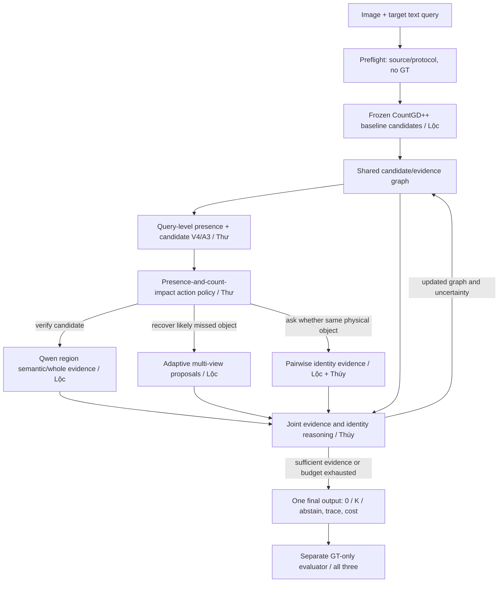

# UNICOUNT v2 — joint presence, count and identity pipeline

The directed cycle is a **proposed active decision algorithm**, not part of the verified runtime yet. The current `src/countlab/integrations/online.py` is mainly a fixed controller/replay path, not the count-impact-aware policy proposed here.

## Ownership and feedback semantics

- **Lộc:** CountGD++ official pseudo3 protocol and separate single-pass comparator; proposal recovery, Qwen region unary verification and frozen pairwise evidence backend.
- **Thư:** fuse V4/A3 with graph-derived ambiguity into estimated effect on `N=0` versus `N>0`, then choose the next action based on expected effect/cost. No learned calibration before approved TRAIN/DEV/CAL.
- **Thúy:** identity constraints including baseline AND rescue nodes, contradictory-evidence handling, absent/positive/unknown decision and final count from distinct accepted physical instances.

## Critical safety semantics

`no detected box` != `verified absent`. `Qwen global NO` != guaranteed absence. Preserve `UNKNOWN`/abstain when source coverage is insufficient; if a target region is already reliably verified, never force final count to zero solely because of a global negative gate. Decisions are empirical, not logically certified scene absence.

## Candidate/identity contract

- Reuse `countlab_candidate_pool_v1` to start; extend only through a reviewed new version.
- IDs, view provenance, image pixels, source hashes, and pairwise evidence must remain exact. No IoU or row-order joins for V4/A3 features.
- Current `N = baseline - rejected + accepted rescues` and complete-link rules remain **v1 comparators**, not evidence of a globally optimal v2 solver.
